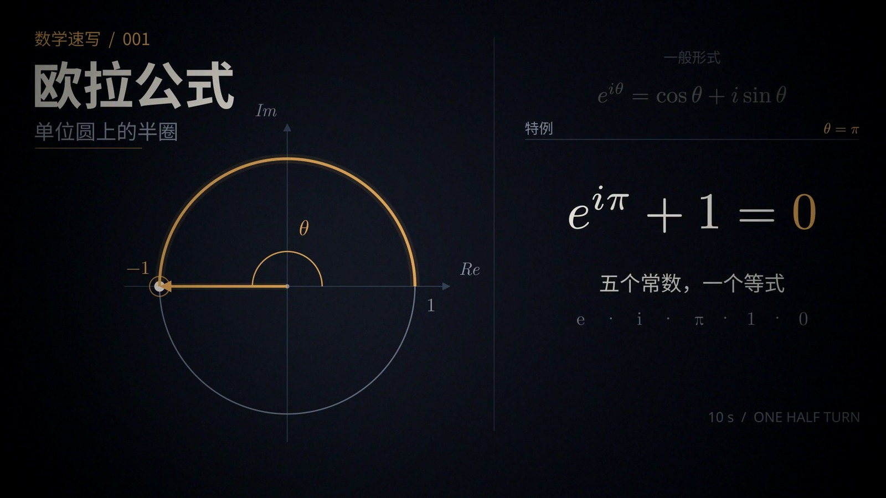

# dark-editorial

暗场编辑风格包。完整规范在 [STYLE.md](STYLE.md)，颜色、字体、运动与音频参数的可复用数值在 [tokens.json](tokens.json)。



## 文件

| 文件 | 作用 |
|---|---|
| `STYLE.md` | 定位、颜色、字体、版面、运动、声音、检查清单 |
| `tokens.json` | 颜色、字体、运动、音频的可复用数值；改这些先改这里 |
| `theme.py` | 读取 tokens，提供 `apply_config()` 与 `backdrop()` |
| `reference/` | 参考场景与音频源码，从 `episodes/euler` 复制 |
| `preview.jpg` | 参考帧，来自 `episodes/euler` |

## 在场景里用

最简单的方式：把 `theme.py` 和 `tokens.json` 复制到分集目录，然后：

```python
import manimgx as m
from theme import ACCENT, GROUND, INK, apply_config, backdrop

apply_config()  # 1920×1080, 60 fps, #0B0F16

class MyScene(m.Scene):
    def construct(self):
        self.add(backdrop())  # 以单位圆圆心为中心的径向渐变
```

如果不想复制，也可以把风格目录加到 `sys.path`：

```python
import sys
from pathlib import Path

STYLE_DIR = Path(__file__).resolve().parents[2] / "styles" / "dark-editorial"
sys.path.insert(0, str(STYLE_DIR))

from theme import apply_config, backdrop
```

`parents[2]` 适用于 `episodes/<slug>/scene.py`；目录更深时自行调整。

## 引用方式

分集 `DESIGN.md` 头部写：

```yaml
---
style: dark-editorial
style_version: 1.0.0
---
```

需要另一种语言时，在分集 `DESIGN.md` 里覆盖，不要改这个风格包。

## 版本

当前 `1.0.0`，从 `episodes/euler` 提取。  
改颜色、字体、版面或时间表：升版本号，并同步 `tokens.json`、`theme.py` 和 `STYLE.md`。
